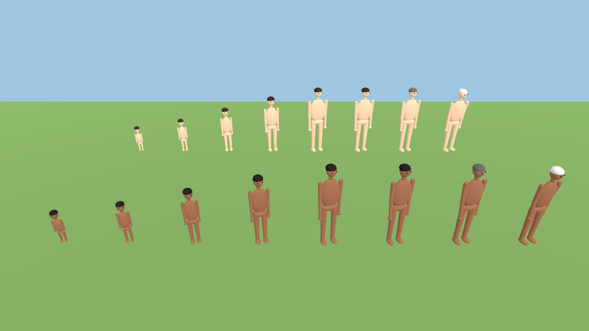
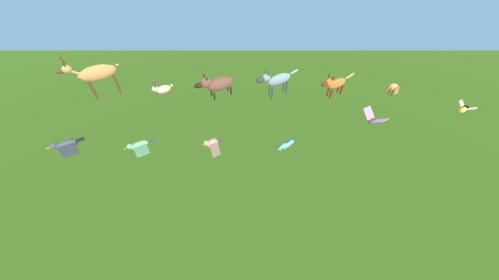

# CAITANYA witness client (Godot 4.4)

A **read-only** 3D viewer. It fetches the world's terrain once (`/api/v1/terrain`), then polls `/api/v1/live`
about once a second and smooths movement between updates. It sends only HTTP GET requests; a test fails if any
script in this folder ever uses another method. It cannot command, feed or influence inhabitants.

## Run it
1. Start a simulation (mock policy, no GPU needed):
   `python -m caitanya.server --population 12 --port 8000 --run-dir runs/local`
2. Open this folder in Godot 4.4 (Compatibility renderer, works on laptops without a GPU), press Play, or:
   `godot --path godot -- --server=http://127.0.0.1:8000`

To watch a finished run, use playback (`python -m caitanya.server --playback <run folder>`, see `docs/PLAYBACK.md`) and point Godot at it.
Keep the server on `localhost` (or reach it through SSH port-forwarding / a private network): the app has no login.

## Controls
right-drag orbit, wheel zoom, WASD or shift+left-drag pan, click a person to inspect (needs, plan and who chose it),
`F` focus on the people, `G` focus on the animals, `B` speech bubbles on/off.
Watching a finished run (playback) adds a bar along the bottom: `space` pause/resume, `←`/`→` step one tick, `[` `]` slower/faster
(0.5-8 ticks a second), `Home`/`End`, or drag the bar to any recorded tick. These only choose which recorded moment is shown
(`GET /api/v1/live?tick=N`); nothing is written and no decision is made.

## Hazard zones
A lasting hazard (wildfire, floodwater, heatwave, severe storm) is drawn as a translucent coloured disc that follows the ground out to its
stated radius, with a stronger rim and a plain label, and is listed in the top line. It disappears the moment the API stops listing it.
This is only a picture of what the simulation published; inhabitants are told nothing by it.

## Options (after `--`)
`--server=URL` `--poll=SECONDS` `--select=agent-0003` `--focus=agent-0003|<animal id>|animals` and, for automated checks, `--screenshot=out.png --wait=SECONDS`
(saves a frame after that many seconds of live data and quits). Playback only: `--start-tick=N` and `--paused`.

## Clothing
Nothing in the simulation makes, wears or loses clothes: each person only carries a recorded `clothing_color` that no rule uses. So both viewers
draw people **bare by default** (skin on every part, feet included) rather than imply a civilisation's tailoring that the world has not
earned. `--clothing` (Godot) or `?clothing=1` (browser viewer) paints that recorded colour as a plain tunic and trousers.
If a clothing mechanic is ever added it must be a physical rule (materials worn on the body), and the viewers should then draw what is worn.

## People who grow
Every person is built from primitives (`human.gd`) using the simulation's recorded `age_years`, `height_cm`, gender, skin tone and
clothing, so one person visibly grows: an infant's head is about a quarter of their height, a child's legs are short, an adolescent
is between, an adult is about 1/7.5, and an elder stoops and greys (`human_proportions.gd`; stage ages are tied to
`caitanya/lifecycle.py` by a test). Height always comes from the simulation; only the shape depends on age, and the shape is a
stylised display choice, not medical data. The body reshapes in place as `age_years` changes. Poses come from the same recorded-state
rule as everyone else (`animation_map.gd`): walk only when really moving, sit for a recent rest, and so on.

(`OUT=pic.png xvfb-run -a godot --path godot --rendering-driver opengl3 --script res://tests/human_gallery.gd` reproduces the picture.)
By default everyone is drawn this way. `--humans=models` uses the fetched rigged models for adults only (a scaled adult model cannot
show a child's proportions, so children are always drawn procedurally).

## Speech bubbles
What inhabitants recently **said** appears in a bubble above their head (`speech` in `/api/v1/live`: `speak` and `teach` lines from the last
12 ticks, truncated to 160 characters, 90 in the bubble). A bubble lasts 4-11 seconds depending on length, at most 14 are shown at once (nearest
first, stacked when speakers are close), and none for speakers farther than 70 units. Press `B` to switch them off and on.

**Thoughts are private.** A recorded reflection is shown only as a light-blue "..." bubble, with no text: reflection text is never in any
event or API (a test plants a secret thought and checks it appears nowhere). Showing what a model privately thinks would need a deliberate,
separate decision to expose private text to the operator; nothing here does that. Writings, hypotheses, memories and stated reasons are never
included either.

## Hundreds of people
Only the people near the camera get the full articulated body (at most 60, built the first time someone comes close, and hidden again when
they are far); everyone else is a **crowd figure** drawn with two MultiMeshes, so a crowd costs a handful of draw calls. The selected person
always gets a full body within 90 units. Animals farther than 55 units are not animated and beyond 150 are hidden. Bodies share their
meshes and materials. People drawn this way still move, face their direction and grow (a crowd figure's height follows `height_cm`).

Measured with `godot/tests/crowd_benchmark.gd` (100 animals; renderer counts from a software-GL run, so they do not depend on your GPU;
the camera is either "near" = low over the middle of the crowd, or "far"):

| People, camera | Draw calls old -> new | Scene nodes old -> new | First build old -> new |
|---|---|---|---|
| 300, near | 2,182 -> 417 | 11,154 -> 3,220 | 312 ms -> 44 ms |
| 500, near | 3,507 -> 406 | 17,554 -> 4,040 | 487 ms -> 41 ms |
| 300, far | 3,981 -> 502 | 11,154 -> 1,856 | 338 ms -> 38 ms |
| 500, far | 6,556 -> 498 | 17,554 -> 2,056 | 633 ms -> 42 ms |

Script work per frame (headless) went from 6.9 / 7.9 / 12.3 ms (100 / 300 / 500 people) to a flat 6.8 ms. A 300-person live poll is about
283 KB of JSON a second. Not measured: real frame rates on a GPU (this sandbox has none; the figures above are counts and script time).
`--humans=models` (rigged models) is not level-of-detail managed and is meant for small casts.

## Animated characters (optional)
The viewer draws simple figures out of the box. To use animated, rigged people, fetch the models once (they are
third-party CC-BY assets and are **not stored in this repository**):

    SKETCHFAB_API_TOKEN=... python scripts/fetch_assets.py      # your own token; writes credits to godot/assets/ATTRIBUTIONS.md
    godot --headless --import --path godot                      # or just open the project once in the Godot editor

Animation follows what the simulation **recorded**, never a script (`animation_map.gd`, tested): real movement ->
walk; a recent `rest`/`rest_for`/`reflect` -> seated pose (shown as a neutral pose, deliberately not labelled with any
meaning); `speak`/`teach` -> talking; gathering, handling objects and experiments -> bending to work; anything else,
or no recorded action, -> idle. There is no running, fighting or hunting state because the simulation has no such
actions yet. A model lacking a clip for a state falls back to idle. The inspector shows the last recorded action.

Display choices (visual only): the gender label picks the model (the nonbinary and unspecified ones alternate by
agent number); `height_cm` scales the body; each model's measured size, clip names and seat height are in
`godot/assets/manifest.json`.

## What it shows today
Terrain and biomes from the simulation's own heightmap, day/night from the world clock, inhabitants (colour, build,
age), resources, objects, fires (with light) and each inhabitant's current plan. Wildlife is drawn when the server's
`/api/v1/live` carries a `wildlife` block (not yet verified visually: wildlife is not merged into `main`).

Contract: [docs/WITNESS_API.md](../docs/WITNESS_API.md). Tooling for development: `scripts/setup_godot_tools.sh`.

## Animals
Wildlife from `/api/v1/live` is drawn as low-poly animals, one silhouette per species (`animal_builder.gd`; deer
show antlers only when the recorded sex is male). Colour and sex come from the simulation. Size and shape are display
choices; insects are drawn larger than life so they can be seen. Poses come from `animal_motion.gd` and only from what
the simulation **recorded** (`resting`, `foraging`, `hunting`, `avoiding predator`, `grazing aquatic food`,
`swimming`, `flying`, `roaming`) plus real movement: legs swing only while the animal actually moves, a bird is
airborne only when recorded as flying, and an unknown action is an idle animal. A test cross-checks that list
against `fauna/ecology.py`. The picture above is reproducible: `OUT=pic.png xvfb-run -a godot --path godot --rendering-driver opengl3 --script res://tests/animal_gallery.gd`. Press `G` to focus the animals, or start with `--focus=<animal id>`.

